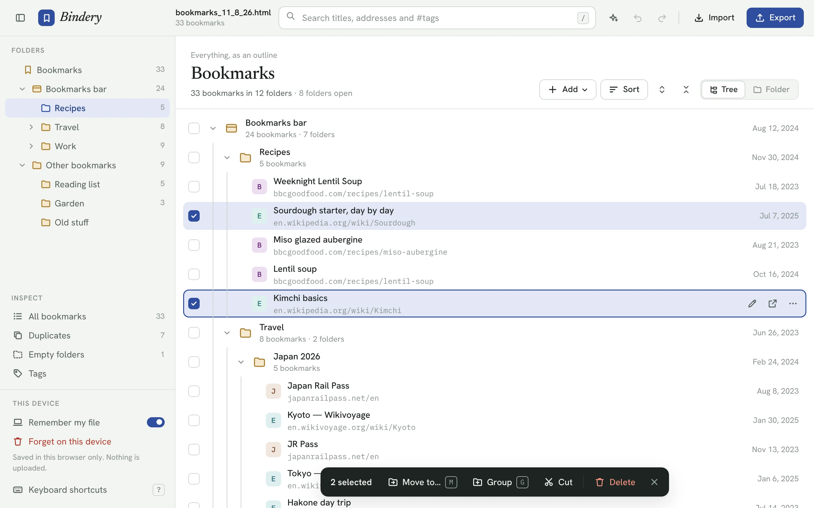

# Bookmark Bindery

**Tidy years of bookmarks in minutes, right in your browser.**

Open the bookmarks file your browser exports, see every folder and link at once, clear out duplicates, reorganize with
drag and drop, add new bookmarks, and export a clean file that Chrome imports straight back. No account and nothing to
install. Your bookmarks stay in your browser unless you turn on the optional AI help, Bindery Assist, which only
sends what each action needs.

**[Open Bookmark Bindery →](https://bookmark-bindery.onrender.com)**

[](LICENSE)


<picture>
  <source media="(prefers-color-scheme: dark)" srcset="docs/screenshots/library-dark.webp">
  
</picture>

- [Why Bookmark Bindery](#why-bookmark-bindery)
- [How to use it](#how-to-use-it)
- [Everything Bindery can do](#everything-bindery-can-do)
- [Bindery Assist (optional AI)](#bindery-assist-optional-ai)
- [Privacy and storage](#privacy-and-storage)
- [Limitations and caveats](#limitations-and-caveats)
- [Hosting your own](#hosting-your-own)
- [Under the hood (TL;DR)](#under-the-hood-tldr)

## Why Bookmark Bindery

- **See everything.** Browse the whole library as one expandable tree, or one folder at a time. Search titles and
  addresses across every folder as you type, filter the folder list by name, and expand or collapse every folder at
  once.
- **Clear out duplicates safely.** Find copies by address, name or both. Choose which to keep, one by one or with "keep
  the oldest in each group", and check before anything is deleted.
- **Reorganize fast.** Drag and drop, cut and paste, **Move to…**, group a selection into a new folder, and sort by
  name, date or website. Or turn on **Keep everything A to Z**, which keeps every folder in order as you edit and
  exports in that order. There are keyboard shortcuts for all of it.
- **Add bookmarks.** **New bookmark** takes an address, a name and a folder. With Bindery Assist on, the page's name and
  icon fill in by themselves, and Assist can suggest a folder.
- **Undo anything.** Every change can be undone, up to 200 steps back.
- **Refuses broken files.** Before opening a file, Bindery checks that it's complete. A file that's cut off, damaged,
  binary, a JSON backup or not a bookmarks export is turned away with a reason, instead of opening with bookmarks
  quietly missing.
- **Private by design.** Everything happens in your browser. The page's security policy only lets it connect to Google
  Fonts and, where it's set up, Bindery Assist's helper. Assist is off until you turn it on.
- **Optional AI help.** Bindery Assist can sort a cluttered folder into named folders, suggest folder names, clean up
  bookmark titles, and fill in new bookmarks. You review every suggestion before anything changes.
- **Round-trips cleanly.** Exports keep each bookmark's dates, icon and descriptions, the bookmarks bar stays the
  bookmarks bar, and the file comes out in exactly the order you see in Bindery.

<table>
  <tr>
    <td width="68%"><picture> <source media="(prefers-color-scheme: dark)"
    srcset="docs/screenshots/duplicates-dark.webp"> 
</picture></td>
    <td width="32%"><picture>
  <source media="(prefers-color-scheme: dark)" srcset="docs/screenshots/phone-dark.webp">
  
</picture></td>
  </tr>
</table>

## How to use it

1. **Export your bookmarks.** In Chrome or Edge, open the Bookmark Manager (Ctrl+Shift+O, or ⌘+Option+B on a Mac),
   click ⋮ and choose **Export bookmarks**. In Firefox, open the Library and choose **Export Bookmarks to HTML**. In
   Safari, choose **File → Export → Bookmarks**.
2. **Open the file** in [Bookmark Bindery](https://bookmark-bindery.onrender.com): click **Import**, or drop it onto
   the page.
3. **Tidy up.** Rename, move, group, sort, add and delete. Check **Duplicates** and **Empty folders** under
   **Inspect**. Press **?** for every keyboard shortcut.
4. **Export** a new file, then import it in your browser's bookmark manager. In Chrome: Bookmark Manager → ⋮ →
   **Import bookmarks**.

Importing adds the file to the bookmarks you already have; it doesn't replace them, and Chrome may put them in a folder
called "Imported". To end up with only the tidied set, keep your original export as a backup, delete the old bookmarks
in your browser, then import Bindery's file.

## Everything Bindery can do

**Opening files**

- Opens the `.html` bookmarks file that Chrome, Edge, Firefox and Safari export, from **Import** or by dropping it on
  the page
- Checks the file first, and refuses files that are cut off, damaged, binary, JSON backups or not bookmark exports,
  saying why
- Reopens your library on your next visit (unless you turn that off)

**Browsing and finding**

- Browse the whole library as an expandable tree, or one folder at a time (**T** switches)
- Search titles and addresses across every folder as you type (**/**)
- Filter the sidebar's folder list by name (**F**), and expand or collapse all its folders at once
- **All bookmarks** and **Empty folders** views under **Inspect**

**Organizing**

- Rename, and edit addresses
- Move by drag and drop, cut and paste, or **Move to…** (with a folder search)
- Group a selection into a new folder
- Sort a folder once by name, newest, oldest or website, with folders first
- **Keep everything A to Z**: every folder lists its subfolders, then its bookmarks, each A to Z, with the bookmarks bar
  first. New, renamed and moved items go straight to their place.
- Delete, with a confirmation that lists what goes when it's more than one item
- Undo and redo, up to 200 steps

**Cleaning up**

- Find duplicates by address, name or both, mark which copies to keep, and delete the rest in one step
- Find empty folders, including folders that only hold other empty folders
- Remove the query string (everything after "?") from an address, with a before-and-after preview

**Adding**

- **New bookmark** (header button, **B**, or **New bookmark here…** in the sidebar's folder menu): an address, a name
  and a folder, with a warning when the address is already saved

**Exporting**

- Writes a standard bookmarks `.html` file that Chrome's Bookmark Manager (and other browsers) can import, named the
  way Chrome names exports

**With Bindery Assist on** (see below)

- Tidy a cluttered folder into suggested folders, reviewed bookmark by bookmark
- Suggest folder names while you rename
- Clean up cluttered bookmark titles
- Fill in a new bookmark's name and icon, and suggest a folder for it

**Keyboard shortcuts**

| Keys | Does |
| --- | --- |
| ↑ ↓ (Shift to extend), Home, End | Move through items |
| → ← | Open a folder, or go up. In the tree: expand or collapse, then step in or out |
| Alt+↑ | Go up to the parent folder |
| T | Switch between the tree and one folder at a time |
| / or Ctrl/⌘+K | Search |
| F | Filter the sidebar's folder list |
| Enter or F2 | Rename (Tab moves to the address) |
| N | New folder |
| B | New bookmark |
| M | Move the selection |
| G | Group the selection into a new folder |
| Ctrl/⌘+X, Ctrl/⌘+V | Cut, then paste into the open folder |
| Delete | Delete the selection |
| Ctrl/⌘+Z, Ctrl/⌘+Shift+Z (or Ctrl+Y) | Undo, redo |
| Ctrl/⌘+A, Space, Esc | Select everything in view, toggle the item under the cursor, clear the selection |
| K, D | Duplicates: keep, or mark for deletion. Tidy review: move, or leave where it is |
| M (in Tidy review) | Send the selection to a different suggested folder |
| ? | Show every shortcut |

## Bindery Assist (optional AI)

<picture>
  <source media="(prefers-color-scheme: dark)" srcset="docs/screenshots/assist-dark.webp">
  
</picture>

Bindery Assist is off until you turn it on. Click ✦ in the top bar, or pick an AI action from a menu, and a welcome
sheet explains each feature and what gets sent. Nothing is sent unless you choose **Turn on Bindery Assist**. While
it's on, the ✦ button is solid purple. Turn it off any time from ✦ → **Turn off Bindery Assist**.

- **Tidy into folders** (a folder's menu, or ✦): suggests folders for the bookmarks in a cluttered folder, reusing the
  subfolders it already has, then opens a review of the whole plan in the main pane. Every bookmark is listed under the
  folder it would go to. Rename a suggested folder by clicking its name: a name that matches an existing subfolder
  adds to it, and one that matches another suggestion merges the two. Set single bookmarks or whole folders to
  **Move** or **Stay**, or drag bookmarks (or select them and press **M**) to a different folder. Nothing changes
  until **Apply**, which is one undo step. You can leave the review and come back to it from **Tidy plan** in the
  sidebar.
- **Suggest names**: while you rename a folder that has something in it (including the new folder **Group** makes),
  tap **Suggest names** under the name field, then tap a suggestion. **Suggest a name…** in a folder's menu does the
  same.
- **Clean up titles** (a bookmark's menu, a selection, or a whole folder from ✦): suggests shorter titles for
  bookmarks stuffed with site names, "(3)" unread counts and SEO filler. Untick any you'd rather keep as they are.
- **Fill in new bookmarks**: in **New bookmark**, paste an address and the page's name and icon fill in. The name stays
  editable, and a name you've typed is never overwritten. Tap **Suggest a folder** for up to three folders that fit,
  then tap one.

**What's sent, and where.** Requests go to Bindery's helper, a small Cloudflare Worker that asks a Workers AI model
(Llama 3.3 70B) and checks its answer. The helper doesn't store or log what it's sent. Cloudflare's own terms cover how
Workers AI handles requests.

| Action | What's sent |
| --- | --- |
| Tidy into folders | The folder's name, its subfolders' names, and the titles and trimmed addresses of the bookmarks directly in it |
| Suggest names | The folder's current name, and the titles and trimmed addresses of up to 60 items directly in it |
| Clean up titles | The titles and trimmed addresses of the chosen bookmarks |
| New bookmark: name and icon | The full address you typed. The helper fetches that page from Cloudflare's servers |
| Suggest a folder | The new bookmark's name and trimmed address, and the names of up to 400 of your folders |

A trimmed address is the site and path only, with nothing after "?" or "#". Bookmarklets and local `file:` addresses
send no address at all. Nothing else from your library is sent.

## Privacy and storage

Everything except Bindery Assist runs in your browser. The page's Content Security Policy only allows connections to
Google Fonts (for the typefaces) and, on a site where Assist is set up, to Assist's helper. Bindery never loads
anything from the sites you've bookmarked: icons come from your bookmarks file, or from Assist when you add a bookmark.

Your library is saved only in this browser's local storage, so it reopens on your next visit. Under **This device** in
the sidebar:

- **Remember my file** (on by default): turn it off and Bindery deletes its saved copy and saves nothing until you turn
  it back on. Your file then lasts only as long as the tab.
- **Forget on this device**: deletes the saved copy, closes your file and clears undo history. Files on your computer
  aren't touched. Your settings (layout, A to Z order, and whether Assist is on) are kept.

Your browser may keep traces in its own storage files after a delete until they're overwritten. To clear those as well,
delete the site's data in your browser settings.

## Limitations and caveats

**Files and formats**

- Bindery only opens the HTML bookmarks file browsers export. It can't open JSON backups, and it can't read or change
  your browser's bookmarks directly: changes reach your browser only when you export and import.
- One file is open at a time. Opening another replaces it, after asking if there are edits you haven't exported.
- Separator lines in Firefox exports aren't kept. They're dropped when the file opens, so the export has none.
- Descriptions, Firefox tags and keywords, and any other details in the file are kept and exported, but Bindery doesn't
  show them or let you edit them.
- Icons only show for bookmarks whose icon is saved in the file. The rest get a colored letter.
- Importing into a browser adds to the bookmarks already there (see [How to use it](#how-to-use-it)).

**Saving and undo**

- Your library is saved in this browser only. It doesn't sync to other browsers or devices, and a private window may
  not keep it.
- Very large libraries (over about 4.5 million characters once saved, which icons add to quickly) aren't saved in the
  browser. They still work in the open tab; export to keep your edits. The sidebar says when this happens.
- Undo history lasts only as long as the tab. Reloading keeps your library but clears undo.
- A Tidy plan you haven't applied isn't saved either. Reloading, closing the tab or opening another file discards it.

**Editing and display**

- Search matches plain text in titles and addresses only, and every word has to match.
- Duplicate addresses match when they differ only by http/https, "www." or a trailing slash. Any other difference,
  including the query string, makes them different. Bookmarklets are never duplicates by address.
- While **Keep everything A to Z** is on, you can't reorder by hand. Turn it off under **Sort** to arrange items
  yourself. A to Z follows your browser's language rules.
- Removing a query string can break links to sites that need it. Bindery warns you, and you can undo.
- **New bookmark** needs an open file with at least one bookmark or folder in it; Bindery can't start a library from
  scratch.
- The order you see in the folder and tree views is exactly the order exported. Search, Duplicates and the Tidy review
  group items their own way, so they don't show the exported order.

**Phones and tablets**

- Bindery works on phones, but dragging and dropping may not work with touch. Use **Move to…** or cut and paste
  instead.
- Keyboard shortcuts need a keyboard.

**Bindery Assist**

- Assist needs a helper Worker. The official site has one; a copy of Bindery without one shows no AI features (see
  [Hosting your own](#hosting-your-own)).
- AI suggestions can be wrong or odd. Tidy and Clean up titles show everything for review, and name and folder
  suggestions only apply when you tap one. Answers usually follow the language of your bookmarks, but that isn't
  guaranteed.
- Each visitor can make 20 requests a minute (counted per IP address, so a shared network shares the limit). A Tidy of
  a large folder uses up to five. The helper also runs on a daily Workers AI allowance; if that runs out, Assist shows
  an error until it resets. Any request that takes longer than 45 seconds is cancelled.
- **Tidy into folders** needs at least 4 bookmarks directly in the folder, and only looks at those: bookmarks in its
  subfolders aren't considered, and subfolders aren't moved. It reads up to 750 bookmarks per run, 150 at a time; the
  rest stay where they are. It won't create a new folder for a single bookmark, and one plan can be open at a time.
- **Suggest names** is based on up to 60 items directly in the folder, so it isn't offered for empty folders.
- **Clean up titles** handles up to 100 bookmarks at a time and skips bookmarklets.
- **Name and icon for a new bookmark** come from fetching the page on Cloudflare's servers, not from your browser.
  Pages behind a login show what a logged-out visitor sees. Sites that block automated readers (some news sites, Hacker
  News), pages slower than 8 seconds, and private or local addresses give no name, so you type one. Icons larger than
  48 KB are skipped. The full address is sent, including anything after "?".
- **Suggest a folder** sees your folder list as it is when you tap it, so folders you've just made are included. Only
  folder names are sent, not what's in them, so a folder still called "New folder" gives it nothing to go on. At most
  400 folders are sent, in the order they appear in your library from top to bottom, not counting the top-level
  "Bookmarks" folder; with more than 400, the ones furthest down aren't considered.
- Whether Assist is on is remembered per browser.

## Hosting your own

`index.html` is the whole app, so any static host works: Render, GitHub Pages, Netlify or a plain web server. On Render
it's served as a static site with no build step (publish directory `.`).

This repository's `index.html` points Bindery Assist at the official site's helper, which only answers
`https://bookmark-bindery.onrender.com`. On your own copy, either turn Assist off:

```bash
node scripts/set-ai-endpoint.mjs off
```

or deploy your own helper and point your copy at it, as described in [worker/README.md](worker/README.md). With
Assist off, no AI features appear and the page can't connect anywhere except Google Fonts.

## Under the hood (TL;DR)

- One HTML file with vanilla JavaScript and CSS. No framework, no dependencies, no build.
- Files are checked as raw text first, then parsed with the browser's `DOMParser`. Afterwards, the number of folders
  and bookmarks found is compared with the tags in the file, so nothing can go missing silently.
- Every edit snapshots the tree first, which is what makes everything undoable. A to Z order is applied inside the same
  step, so the export always matches what you see.
- Duplicates are matched on normalized addresses (http/https, `www.` and trailing slashes ignored), names, or both.
- The list only renders the rows on screen, so libraries with thousands of bookmarks stay fast.
- `localStorage` holds your library between visits, and only if you allow it.
- Bindery Assist is a dependency-free Cloudflare Worker (`worker/`) that validates every answer before the page uses
  it, and the page checks again against your library.

For the full tour (file checks, the data model, undo, duplicate rules, Bindery Assist, export format, storage,
rendering and a code map) read **[docs/technical.md](docs/technical.md)**.

## License

[MIT](LICENSE). Use it, change it, host your own copy, share it. Just keep the copyright notice.
