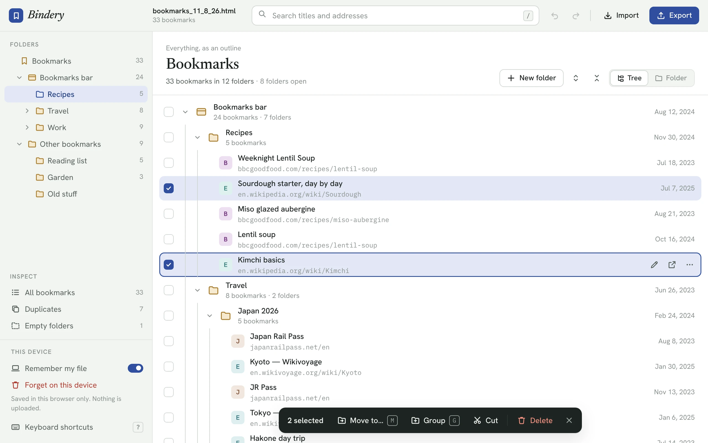
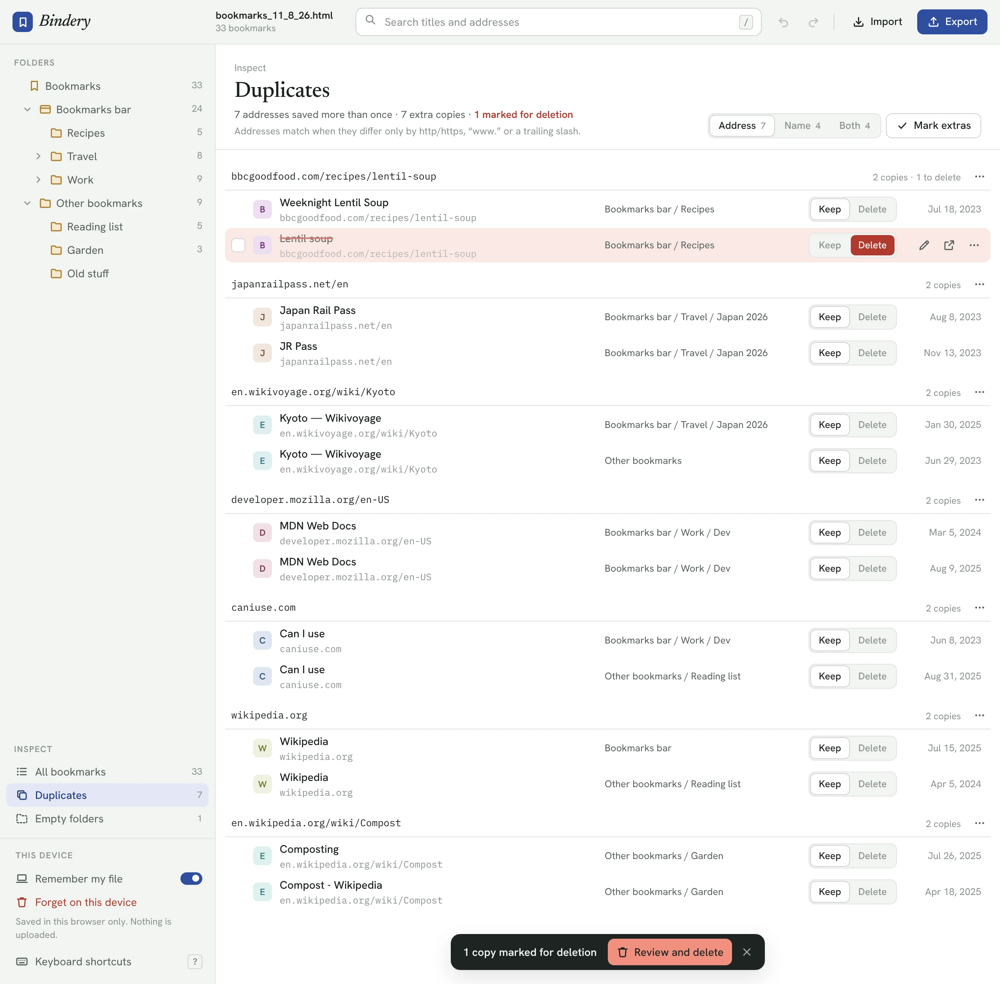
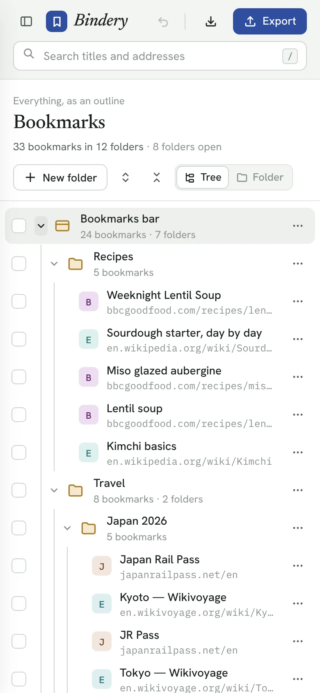

# Bookmark Bindery

**Tidy years of bookmarks in minutes, without them ever leaving your computer.**

Open the bookmarks file your browser exports, see every folder and link at once, clear out duplicates, reorganize with
drag and drop, and export a clean file that Chrome imports straight back. No account, no upload, nothing to install.

**[Open Bookmark Bindery →](https://bookmark-bindery.onrender.com)**

<picture>
  <source media="(prefers-color-scheme: dark)" srcset="docs/screenshots/library-dark.webp">
  
</picture>

## Why Bookmark Bindery

- **See everything.** Browse the whole library as one expandable tree, or one folder at a time. Search titles and
  addresses across every folder as you type.
- **Clear out duplicates safely.** Find copies by address, name or both. Choose which to keep, one by one or with "keep
  the oldest in each group", and check before anything is deleted.
- **Reorganize fast.** Drag and drop, cut and paste, **Move to…**, group a selection into a new folder, sort by name,
  date or site. There are keyboard shortcuts for all of it.
- **Undo anything.** Every change can be undone, up to 200 steps back.
- **Refuses broken files.** Before opening a file, Bindery checks that it's complete. A file that's cut off, damaged,
  binary, a JSON backup or not a bookmarks export is turned away with a reason, instead of opening with bookmarks quietly
  missing.
- **Private by design.** Everything happens in your browser. The page's security policy blocks it from connecting
  anywhere except Google Fonts, so your bookmarks can't be sent anywhere.
- **Round-trips cleanly.** Exports keep each bookmark's dates, icon and descriptions, and the bookmarks bar stays the
  bookmarks bar.

<table>
  <tr>
    <td width="68%"><picture>
  <source media="(prefers-color-scheme: dark)" srcset="docs/screenshots/duplicates-dark.webp">
  
</picture></td>
    <td width="32%"><picture>
  <source media="(prefers-color-scheme: dark)" srcset="docs/screenshots/phone-dark.webp">
  
</picture></td>
  </tr>
</table>

## How to use it

1. **Export your bookmarks.** In Chrome or Edge, open the Bookmark Manager (Ctrl+Shift+O, or ⌘+Option+B on a Mac),
   click ⋮ and choose **Export bookmarks**. In Firefox, open the Library and choose **Export Bookmarks to HTML**. In
   Safari, choose **File → Export → Bookmarks**.
2. **Open the file** in [Bookmark Bindery](https://bookmark-bindery.onrender.com): click **Import**, or drop it onto
   the page.
3. **Tidy up.** Rename, move, group and delete. Check **Duplicates** and **Empty folders** under **Inspect**. Press
   **?** for every keyboard shortcut.
4. **Export** a new file, then import it in your browser's bookmark manager. In Chrome: Bookmark Manager → ⋮ →
   **Import bookmarks**.

Everything Bindery can do:

- Checks each file before opening it, and refuses files that are cut off, damaged, binary, JSON backups or not bookmark
  exports, saying why
- Browse the whole library as an expandable tree or one folder at a time
- Rename, edit addresses, move (drag and drop, cut and paste, Move to…), group and delete, with undo
- Find duplicates by address, name or both, and choose which copies to keep
- Remove query strings from addresses
- Export a Netscape-format bookmarks file that Chrome's Bookmark Manager can import

## Your bookmarks stay on your computer

Everything runs in the browser. The page makes no network requests apart from loading Google Fonts, and its Content
Security Policy blocks any other connection. Your library is kept only in this browser's local storage, so it reopens
on your next visit.

Under **This device** in the sidebar:

- **Remember my file** (on by default): turn it off and Bindery deletes its saved copy and saves nothing until you turn
  it back on. Your file then lasts only as long as the tab.
- **Forget on this device**: deletes the saved copy, closes your file and clears undo history. Files on your computer
  aren't touched.

Your browser may keep traces in its own storage files after a delete until they're overwritten. To clear those as well,
delete the site's data in your browser settings.

## Hosting your own

`index.html` is the whole app, so any static host works: Render, GitHub Pages, Netlify or a plain web server. On Render
it's served as a static site with no build step (publish directory `.`).

## Under the hood (TL;DR)

- One HTML file with vanilla JavaScript and CSS. No framework, no dependencies, no build.
- Files are checked as raw text first, then parsed with the browser's `DOMParser`. Afterwards, the number of folders
  and bookmarks found is compared with the tags in the file, so nothing can go missing silently.
- Every edit snapshots the tree first, which is what makes everything undoable.
- Duplicates are matched on normalized addresses (http/https, `www.` and trailing slashes ignored), names, or both.
- The list only renders the rows on screen, so libraries with thousands of bookmarks stay fast.
- `localStorage` holds your library between visits, and only if you allow it.

For the full tour (file checks, the data model, undo, duplicate rules, export format, storage, rendering and a code
map) read **[docs/technical.md](docs/technical.md)**.

## License

[MIT](LICENSE). Use it, change it, host your own copy, share it. Just keep the copyright notice.
