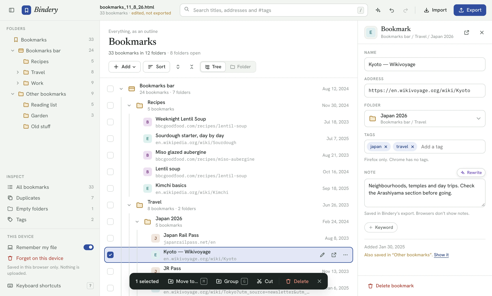
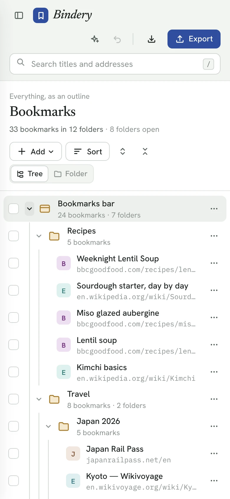
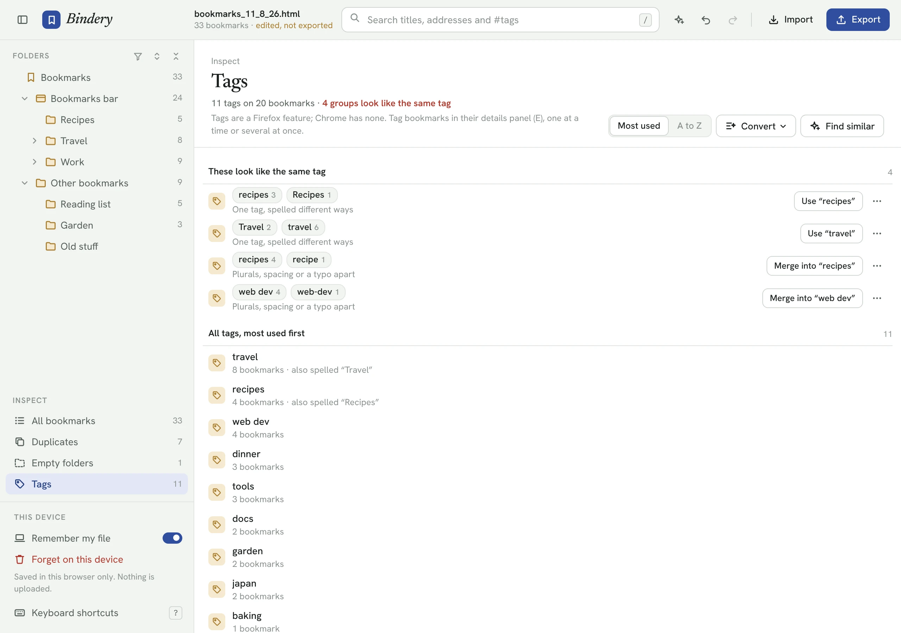
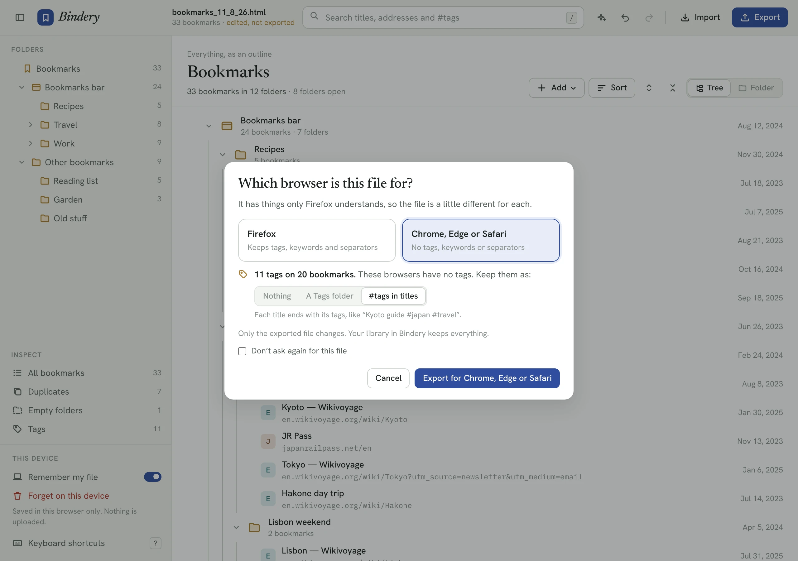
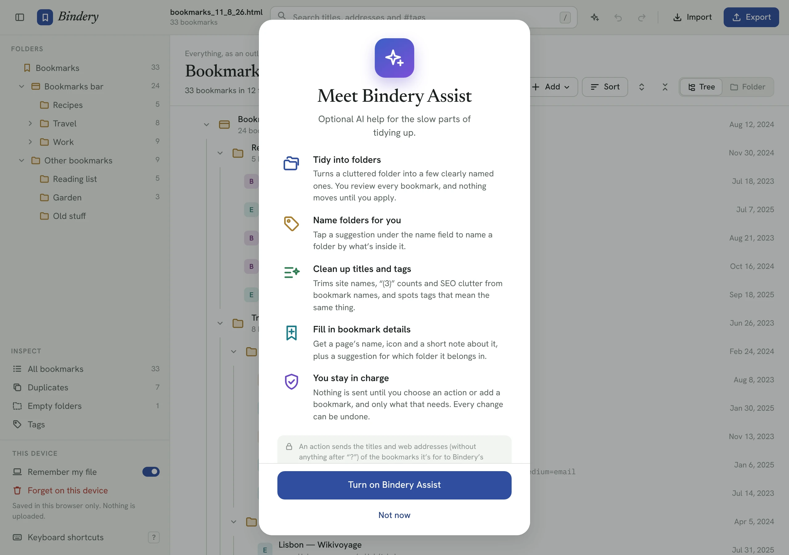

# Bookmark Bindery

**Tidy years of bookmarks in minutes, right in your browser.**

Open the bookmarks file your browser exports, see every folder and link at once, clear out duplicates, reorganize with
drag and drop, tag and annotate, and export a clean file for Chrome, Edge, Safari or Firefox. No account and nothing to
install. Your bookmarks stay in your browser unless you turn on the optional AI help, Bindery Assist, which only
sends what each action needs.

**[Open Bookmark Bindery →](https://bookmark-bindery.onrender.com)**

[](LICENSE)


<picture>
  <source media="(prefers-color-scheme: dark)" srcset="docs/screenshots/library-dark.webp">
  
</picture>

- [Why Bookmark Bindery](#why-bookmark-bindery)
- [How to use it](#how-to-use-it)
- [Everything Bindery can do](#everything-bindery-can-do)
- [Firefox and other browsers](#firefox-and-other-browsers)
- [Bindery Assist (optional AI)](#bindery-assist-optional-ai)
- [Privacy and storage](#privacy-and-storage)
- [Limitations and caveats](#limitations-and-caveats)
- [Hosting your own](#hosting-your-own)
- [Under the hood (TL;DR)](#under-the-hood-tldr)

## Why Bookmark Bindery

- **See everything.** Browse the whole library as one expandable tree, or one folder at a time. Search titles,
  addresses and tags across every folder as you type, filter the folder list by name, and expand or collapse every
  folder at once.
- **Clear out duplicates safely.** Find copies by address, name or both. Choose which to keep, one by one or with "keep
  the oldest in each group", and check before anything is deleted.
- **Reorganize fast.** Drag and drop, cut and paste, **Move to…**, group a selection into a new folder, and sort by
  name, date or website. Or turn on **Keep everything A to Z**, which keeps every folder in order as you edit and
  exports in that order. There are keyboard shortcuts for all of it.
- **Edit in one place.** A details panel beside the list shows a bookmark's name, address, folder, tags, keyword and
  note, and every change applies as you make it, ready to undo. Fields you don't use stay out of the way.
- **Tags that stay tidy.** A Tags view lists every tag, finds the ones that look like the same tag (`Recipes`,
  `recipe`, `recipes`) and merges them in a click. Rename, merge or remove a tag everywhere, tag many bookmarks at once,
  or turn tags into folders and back.
- **Made for Firefox too.** Firefox's tags, keywords and separators are kept, shown and editable. When you export,
  Bindery asks which browser the file is for and says exactly what Chrome, Edge or Safari would lose.
- **Add bookmarks.** **+ Add → New bookmark** opens the same panel for an address, a name and a folder. With Bindery
  Assist on, the page's name and icon fill in by themselves, and Assist can suggest a folder and write a note.
- **Undo anything.** Every change can be undone, up to 200 steps back.
- **Refuses broken files.** Before opening a file, Bindery checks that it's complete. A file that's cut off, damaged,
  binary, a JSON backup or not a bookmarks export is turned away with a reason, instead of opening with bookmarks
  quietly missing.
- **Private by design.** Everything happens in your browser. The page's security policy only lets it connect to Google
  Fonts and, where it's set up, Bindery Assist's helper. Assist is off until you turn it on.
- **Optional AI help.** Bindery Assist can sort a cluttered folder into named folders, suggest folder names, clean up
  bookmark titles, find tags that mean the same thing, and fill in a bookmark's name, icon and note. You review every
  suggestion before anything changes.
- **Round-trips cleanly.** Exports keep each bookmark's dates, icon and note, the bookmarks bar stays the bookmarks bar,
  and the file comes out in exactly the order you see in Bindery.

<picture>
  <source media="(prefers-color-scheme: dark)" srcset="docs/screenshots/editor-dark.webp">
  
</picture>

<table>
  <tr>
    <td width="68%"><picture>
  <source media="(prefers-color-scheme: dark)" srcset="docs/screenshots/duplicates-dark.webp">
  
</picture></td>
    <td width="32%"><picture>
  <source media="(prefers-color-scheme: dark)" srcset="docs/screenshots/phone-dark.webp">
  
</picture></td>
  </tr>
</table>

## How to use it

1. **Export your bookmarks.** In Chrome or Edge, open the Bookmark Manager (Ctrl+Shift+O, or ⌘+Option+B on a Mac),
   click ⋮ and choose **Export bookmarks**. In Firefox, open the Library (Ctrl+Shift+O, or ⌘+Shift+O on a Mac) and
   choose **Import and Backup → Export Bookmarks to HTML**. In Safari, choose **File → Export → Bookmarks**.
2. **Open the file** in [Bookmark Bindery](https://bookmark-bindery.onrender.com): click **Import**, or drop it onto
   the page.
3. **Tidy up.** Rename, move, group, sort, tag, add and delete. Check **Duplicates**, **Empty folders** and **Tags**
   under **Inspect**. Press **?** for every keyboard shortcut.
4. **Export** a new file. If your library has anything only Firefox understands, Bindery asks which browser the file
   is for. Then import it in that browser: in Chrome, Bookmark Manager → ⋮ → **Import bookmarks**; in Firefox, Library
   → **Import and Backup → Import Bookmarks from HTML**.

Importing adds the file to the bookmarks you already have; it doesn't replace them, and Chrome may put them in a folder
called "Imported". To end up with only the tidied set, keep your original export as a backup, delete the old bookmarks
in your browser, then import Bindery's file.

## Everything Bindery can do

**Opening files**

- Opens the `.html` bookmarks file that Chrome, Edge, Firefox and Safari export, from **Import** or by dropping it on
  the page
- Checks the file first, and refuses files that are cut off, damaged, binary, JSON backups or not bookmark exports,
  saying why
- Says once when a file has things only Firefox understands, and where to find them
- Reopens your library on your next visit (unless you turn that off)

**Browsing and finding**

- Browse the whole library as an expandable tree, or one folder at a time (**T** switches)
- Search titles, addresses and tags across every folder as you type (**/**). Start a word with `#` to match tags only:
  `#trav` finds bookmarks tagged `travel`.
- Filter the sidebar's folder list by name (**F**), and expand or collapse all its folders at once
- **All bookmarks**, **Empty folders** and **Tags** views under **Inspect**
- Drag the edge of the folders pane or the details panel to make it wider or narrower; double-click the edge to put it
  back. The button at the far left of the top bar (or Ctrl/⌘+**B**) folds the folders pane into a slim rail of large
  icons, like the sidebar in VS Code, and opens it again. Dragging the pane very narrow folds it too. Sizes and the
  rail are remembered in this browser.

**Organizing**

- **Details panel** (**E**, double-click a bookmark, or the pencil on a row): name, address, folder, tags, keyword and
  note, each saved as you go. It follows the selection, so you can step through bookmarks with the arrow keys.
- With several items selected, the panel tags them all at once: shared tags show solid, tags only some have show
  dashed with a count (`2/3`) and a **+** to add them to the rest. It also offers Move to…, Group and Delete.
- Rename in place (**Enter** or **F2**), including a bookmark's address
- Notes on bookmarks and folders (exported as the file's descriptions)
- Move by drag and drop, cut and paste, or **Move to…** (with a folder search)
- Group a selection into a new folder
- Sort a folder once by name, newest, oldest or website, with folders first
- **Keep everything A to Z**: every folder lists its subfolders, then its bookmarks, each A to Z, with the bookmarks bar
  first. New, renamed and moved items go straight to their place.
- Separators: keep the ones from Firefox, add one with **+ Add → Separator**, and move or delete them like any item.
  Sorting keeps each separator in place and sorts the sections between them, as Firefox does.
- Delete, with a confirmation that lists what goes when it's more than one item
- Undo and redo, up to 200 steps

**Tags** (Inspect → Tags)

<picture>
  <source media="(prefers-color-scheme: dark)" srcset="docs/screenshots/tags-dark.webp">
  
</picture>

- Every tag with its number of bookmarks, by most used or A to Z. Capitals don't make a different tag: `Travel` and
  `travel` are one tag spelled two ways.
- **These look like the same tag**: one tag spelled different ways, plurals (`recipe`/`recipes`), spacing
  (`web dev`/`web-dev`) and one-letter typos. One click merges a group. The ⋯ menu picks which name to keep, or marks
  them as different so the group stops showing.
- **Find similar** (Bindery Assist): finds tags that mean the same thing, like `js` and `javascript`
- Open a tag to see its bookmarks wherever they are. From there: **Rename** (the name of another tag merges the two),
  **Merge into another tag**, **Make a folder from this tag** (copies, or move the bookmarks, optionally removing the
  tag), and **Remove** it from every bookmark. The bookmarks stay.
- **Convert**: make a folder for each tag (with copies of its bookmarks) or add tags to titles (`Kyoto guide #japan
  #travel`), for browsers without tags; or tag bookmarks with the names of the folders they're in, for Firefox
- Keywords, Firefox's address-bar shortcuts: set them in the details panel, with a warning when two bookmarks share one

**Cleaning up**

- Find duplicates by address, name or both, mark which copies to keep, and delete the rest in one step
- Find empty folders, including folders that only hold other empty folders
- Find and merge look-alike tags
- Remove the query string (everything after "?") from an address, with a before-and-after preview

**Adding**

- **+ Add** in the header: **New bookmark** (**B**), **New folder** (**N**) or **Separator**. The sidebar's folder menu
  also has **New bookmark here…**
- New bookmark opens the details panel: an address, a name and a folder, plus tags, a keyword or a note if you want
  them, with a warning when the address is already saved

**Exporting**

- Writes a standard bookmarks `.html` file that browsers import, named the way Chrome names exports
- Asks which browser it's for when that matters (see [Firefox and other browsers](#firefox-and-other-browsers))

**With Bindery Assist on** (see below)

- Tidy a cluttered folder into suggested folders, reviewed bookmark by bookmark
- Suggest folder names while you rename
- Clean up cluttered bookmark titles
- Find tags that mean the same thing
- Fill in a new bookmark's name and icon, suggest a folder for it, and write a note for any bookmark

**Keyboard shortcuts**

| Keys | Does |
| --- | --- |
| ↑ ↓ (Shift to extend), Home, End | Move through items |
| → ← | Open a folder, or go up. In the tree: expand or collapse, then step in or out |
| Alt+↑ | Go up to the parent folder |
| T | Switch between the tree and one folder at a time |
| / or Ctrl/⌘+K | Search (start a word with # for tags) |
| F | Filter the sidebar's folder list |
| Ctrl/⌘+B | Fold the folders pane into a rail of icons, or open it again |
| Drag a pane's edge | Resize the folders pane or the details panel (double-click to reset) |
| E | Edit details in the side panel |
| Enter or F2 | Rename in place (Tab moves to the address) |
| N | New folder |
| B | New bookmark |
| M | Move the selection |
| G | Group the selection into a new folder |
| Ctrl/⌘+X, Ctrl/⌘+V | Cut, then paste into the open folder |
| Delete | Delete the selection |
| Ctrl/⌘+Z, Ctrl/⌘+Shift+Z (or Ctrl+Y) | Undo, redo |
| Ctrl/⌘+A, Space, Esc | Select everything in view, toggle the item under the cursor, clear the selection (then close the panel) |
| K, D | Duplicates: keep, or mark for deletion. Tidy review: move, or leave where it is |
| M (in Tidy review) | Send the selection to a different suggested folder |
| Enter or →, F2, Delete (in Tags) | Open the tag, rename it, remove it from every bookmark. ← goes back to all tags |
| ? | Show every shortcut |

## Firefox and other browsers

Firefox bookmarks can have things other browsers don't: **tags**, **keywords** (type one in Firefox's address bar to
open the bookmark), **separator lines**, and **Firefox-only items**, Firefox's own lists such as "Most Visited". Bindery
keeps all of them, shows them and lets you edit them. When you open a file that has any, a short notice lists what it
found and where to find it.

<picture>
  <source media="(prefers-color-scheme: dark)" srcset="docs/screenshots/export-dark.webp">
  
</picture>

When you export a library that has any of them, Bindery asks which browser the file is for:

- **Firefox**: everything is kept.
- **Chrome, Edge or Safari**: these browsers have no tags, keywords or separators, so Bindery lists what's lost and
  lets you choose:
  - **Tags**: leave them behind, add a "Tags" folder with a folder of copies for each tag, or add them to the end of
    titles as `#tags`.
  - **Keywords** won't work there.
  - **Separators** are left out of the file.
  - **Firefox-only items** are left out by default, since they only work in Firefox. You can keep them.

Only the exported file changes; your library in Bindery keeps everything. The choice starts on the browser the file
came from and is remembered with the file. Tick **Don't ask again for this file** to skip the question; the message
after exporting then offers **Choose another browser**. A library with nothing Firefox-specific exports without
asking.

Notes are always kept in the file, but no current browser shows them.

## Bindery Assist (optional AI)

<picture>
  <source media="(prefers-color-scheme: dark)" srcset="docs/screenshots/assist-dark.webp">
  
</picture>

Bindery Assist is off until you turn it on. Click ✦ in the top bar, or pick an AI action from a menu, and a welcome
sheet explains each feature and what gets sent. Nothing is sent unless you choose **Turn on Bindery Assist**. While
it's on, the ✦ button is solid purple. Turn it off any time from ✦ → **Turn off Bindery Assist**.

- **Tidy into folders** (a folder's menu, or ✦): suggests folders for the bookmarks in a cluttered folder, reusing the
  subfolders it already has, then opens a review of the whole plan in the main pane. Every bookmark is listed under the
  folder it would go to. Rename a suggested folder by clicking its name: a name that matches an existing subfolder
  adds to it, and one that matches another suggestion merges the two. Set single bookmarks or whole folders to
  **Move** or **Stay**, or drag bookmarks (or select them and press **M**) to a different folder. Nothing changes
  until **Apply**, which is one undo step. You can leave the review and come back to it from **Tidy plan** in the
  sidebar.
- **Suggest names**: while you rename a folder that has something in it (including the new folder **Group** makes),
  tap **Suggest names** under the name field, then tap a suggestion. **Suggest a name…** in a folder's menu does the
  same.
- **Clean up titles** (a bookmark's menu, a selection, or a whole folder from ✦): suggests shorter titles for
  bookmarks stuffed with site names, "(3)" unread counts and SEO filler. Untick any you'd rather keep as they are.
- **Find similar tags** (Tags view): adds groups of tags that mean the same thing, like `js` and `javascript`, to the
  "look like the same tag" section, where you merge or dismiss them.
- **Fill in bookmark details**: in **New bookmark**, paste an address and the page's name and icon fill in. The name
  stays editable, and a name you've typed is never overwritten. Tap **Suggest a folder** for up to three folders that
  fit, then tap one. For any bookmark, **Write one** next to its note asks for a one- or two-sentence description of
  the page, which you can then edit or undo.

**What's sent, and where.** Requests go to Bindery's helper, a small Cloudflare Worker that asks a Workers AI model
(Llama 3.3 70B) and checks its answer. The helper doesn't store or log what it's sent. Cloudflare's own terms cover how
Workers AI handles requests.

| Action | What's sent |
| --- | --- |
| Tidy into folders | The folder's name, its subfolders' names, and the titles and trimmed addresses of the bookmarks directly in it |
| Suggest names | The folder's current name, and the titles and trimmed addresses of up to 60 items directly in it |
| Clean up titles | The titles and trimmed addresses of the chosen bookmarks |
| Find similar tags | Your tag names (up to the 600 most used), and nothing else |
| New bookmark: name and icon | The full address you typed. The helper fetches that page from Cloudflare's servers |
| Write a note | The bookmark's full address and name. The helper fetches that page from Cloudflare's servers |
| Suggest a folder | The new bookmark's name and trimmed address, and the names of up to 400 of your folders |

A trimmed address is the site and path only, with nothing after "?" or "#". Bookmarklets, local `file:` addresses and
Firefox-only items send no address at all. Nothing else from your library is sent.

## Privacy and storage

Everything except Bindery Assist runs in your browser. The page's Content Security Policy only allows connections to
Google Fonts (for the typefaces) and, on a site where Assist is set up, to Assist's helper. Bindery never loads
anything from the sites you've bookmarked: icons come from your bookmarks file, or from Assist when you add a bookmark.

Your library is saved only in this browser's local storage, so it reopens on your next visit, along with which browser
it came from and your export choice. Under **This device** in the sidebar:

- **Remember my file** (on by default): turn it off and Bindery deletes its saved copy and saves nothing until you turn
  it back on. Your file then lasts only as long as the tab.
- **Forget on this device**: deletes the saved copy, closes your file and clears undo history. Files on your computer
  aren't touched. Your settings (layout, A to Z order, and whether Assist is on) are kept.

Your browser may keep traces in its own storage files after a delete until they're overwritten. To clear those as well,
delete the site's data in your browser settings.

## Limitations and caveats

**Files and formats**

- Bindery only opens the HTML bookmarks file browsers export. It can't open JSON backups (including Firefox's
  `.json` and `.jsonlz4` backups), and it can't read or change your browser's bookmarks directly: changes reach your
  browser only when you export and import.
- One file is open at a time. Opening another replaces it, after asking if there are edits you haven't exported.
- Tags, keywords and separators are Firefox features. Chrome, Edge and Safari have no tags; as far as we know they
  ignore keywords and separators in an imported file. That's why the export asks which browser the file is for.
- No current browser shows notes (the file's descriptions): Firefox removed bookmark descriptions in 2018 (versions
  62–63), and Chrome never had them. Bindery keeps them in its export anyway.
- Whether a file is "from Firefox" is a best guess, from Firefox's folder markers, its "Bookmarks Menu" title, or
  anything only Firefox writes. It decides the notice and which browser the export starts on, and you can always pick
  the other one.
- Any other details in the file (for example, the date a folder was last changed) are kept and exported, but not
  shown or editable.
- Icons only show for bookmarks whose icon is saved in the file. The rest get a colored letter.
- Importing into a browser adds to the bookmarks already there (see [How to use it](#how-to-use-it)).

**Saving and undo**

- Your library is saved in this browser only. It doesn't sync to other browsers or devices, and a private window may
  not keep it.
- Very large libraries (over about 4.5 million characters once saved, which icons add to quickly) aren't saved in the
  browser. They still work in the open tab; export to keep your edits. The sidebar says when this happens.
- Undo history lasts only as long as the tab. Reloading keeps your library but clears undo.
- A Tidy plan you haven't applied isn't saved either, and neither are look-alike tag groups you dismissed or groups
  Bindery Assist found. Reloading, closing the tab or opening another file discards them.

**Editing and display**

- Search matches plain text in titles, addresses and tags, and every word has to match. A word starting with `#`
  matches the start of a tag.
- Duplicate addresses match when they differ only by http/https, "www." or a trailing slash. Any other difference,
  including the query string, makes them different. Bookmarklets are never duplicates by address.
- While **Keep everything A to Z** is on, you can't reorder by hand. Turn it off under **Sort** to arrange items
  yourself. A to Z follows your browser's language rules, and separators stay where they are.
- Removing a query string can break links to sites that need it. Bindery warns you, and you can undo.
- **New bookmark** needs an open file with at least one bookmark or folder in it; Bindery can't start a library from
  scratch.
- The details panel saves each change when you leave the field or press Enter (Ctrl/⌘+Enter for a note), with no Save
  button. Esc in a field puts back what was there. With several items selected, only tags can be edited together;
  names, addresses, keywords and notes are edited one item at a time.
- Pane sizes are kept within limits: the folders pane between 220 and 520 px, the details panel between 300 and 760 px,
  and never so wide that the list gets narrower than 380 px. On screens 820 px wide or less the folders pane is a
  drawer with no rail, and on phones the details panel is a bottom sheet that can't be resized. In Firefox, Ctrl+B
  normally opens Firefox's own bookmarks sidebar; on Bindery's page it folds Bindery's pane instead.
- Keywords can't contain spaces, and Firefox only keeps one bookmark per keyword.
- Separators can't be renamed, and they never count as bookmarks.
- The order you see in the folder and tree views is exactly the order exported. Search, Duplicates, Tags and the Tidy
  review group items their own way, so they don't show the exported order.

**Tags**

- Tags ignore capitals: `Travel` and `travel` are one tag, shown with its most used spelling. Merging or renaming
  changes the spelling on every bookmark.
- Tags can't contain commas (Firefox stores them comma-separated), so a comma typed in a tag starts a new one.
- The look-alike finder catches spellings, plurals ending in "s" or "ies", spacing and hyphens, and one-letter typos in
  tags of five letters or more without digits. It doesn't catch synonyms (that's what **Find similar** is for), and it
  skips the typo check in libraries with more than 3,000 tags.
- **Make a folder from this tag** and **Make a folder for each tag** use copies by default, so the copies show up in
  Duplicates. That's expected. A bookmark with several tags gets a copy in each tag's folder.
- **Add tags to titles** and **Tag bookmarks with their folder names** change your library (each is one undo step).
  Choosing "#tags in titles" or "A Tags folder" when exporting only changes the exported file.

**Phones and tablets**

- Bindery works on phones, but dragging and dropping may not work with touch. Use **Move to…** or cut and paste
  instead.
- Keyboard shortcuts need a keyboard.

**Bindery Assist**

- Assist needs a helper Worker. The official site has one; a copy of Bindery without one shows no AI features (see
  [Hosting your own](#hosting-your-own)).
- AI suggestions can be wrong or odd. Tidy and Clean up titles show everything for review, similar-tag groups only
  merge when you click, and name and folder suggestions only apply when you tap one. Answers usually follow the
  language of your bookmarks, but that isn't guaranteed.
- Each visitor can make 20 requests a minute (counted per IP address, so a shared network shares the limit). A Tidy of
  a large folder uses up to five. The helper also runs on a daily Workers AI allowance; if that runs out, Assist shows
  an error until it resets. Any request that takes longer than 45 seconds is cancelled.
- **Tidy into folders** needs at least 4 bookmarks directly in the folder, and only looks at those: bookmarks in its
  subfolders aren't considered, and subfolders and separators aren't moved. It reads up to 750 bookmarks per run, 150
  at a time; the rest stay where they are. It won't create a new folder for a single bookmark, and one plan can be open
  at a time.
- **Suggest names** is based on up to 60 items directly in the folder, so it isn't offered for empty folders.
- **Clean up titles** handles up to 100 bookmarks at a time and skips bookmarklets.
- **Find similar tags** compares your 600 most used tags. It looks for tags that mean the same, not tags that are
  merely related.
- **Write a note** reads the page the same way as below, using its own description and the start of its text. Pages it
  can't read get no note.
- **Name and icon for a new bookmark** come from fetching the page on Cloudflare's servers, not from your browser.
  Pages behind a login show what a logged-out visitor sees. Sites that block automated readers (some news sites, Hacker
  News), pages slower than 8 seconds, and private or local addresses give no name, so you type one. Icons larger than
  48 KB are skipped. The full address is sent, including anything after "?".
- **Suggest a folder** sees your folder list as it is when you tap it, so folders you've just made are included. Only
  folder names are sent, not what's in them, so a folder still called "New folder" gives it nothing to go on. At most
  400 folders are sent, in the order they appear in your library from top to bottom, not counting the top-level
  "Bookmarks" folder; with more than 400, the ones furthest down aren't considered.
- Whether Assist is on is remembered per browser.

## Hosting your own

`index.html` is the whole app, so any static host works: Render, GitHub Pages, Netlify or a plain web server. On Render
it's served as a static site with no build step (publish directory `.`).

This repository's `index.html` points Bindery Assist at the official site's helper, which only answers
`https://bookmark-bindery.onrender.com`. On your own copy, either turn Assist off:

```bash
node scripts/set-ai-endpoint.mjs off
```

or deploy your own helper and point your copy at it, as described in [worker/README.md](worker/README.md). With
Assist off, no AI features appear and the page can't connect anywhere except Google Fonts.

## Under the hood (TL;DR)

- One HTML file with vanilla JavaScript and CSS. No framework, no dependencies, no build.
- Files are checked as raw text first, then parsed with the browser's `DOMParser`. Afterwards, the number of folders
  and bookmarks found is compared with the tags in the file, so nothing can go missing silently.
- Every edit snapshots the tree first, which is what makes everything undoable. A to Z order is applied inside the same
  step, so the export always matches what you see.
- Duplicates are matched on normalized addresses (http/https, `www.` and trailing slashes ignored), names, or both.
- Tags live where Firefox keeps them, in each bookmark's `TAGS` attribute, and are indexed on every change.
- Exporting for another browser changes a copy of the library, never the library itself.
- The list only renders the rows on screen, so libraries with thousands of bookmarks stay fast.
- `localStorage` holds your library between visits, and only if you allow it.
- Bindery Assist is a dependency-free Cloudflare Worker (`worker/`) that validates every answer before the page uses
  it, and the page checks again against your library.

For the full tour (file checks, the data model, undo, duplicate rules, tags, separators, browser exports, Bindery
Assist, storage, rendering and a code map) read **[docs/technical.md](docs/technical.md)**.

## License

[MIT](LICENSE). Use it, change it, host your own copy, share it. Just keep the copyright notice.
